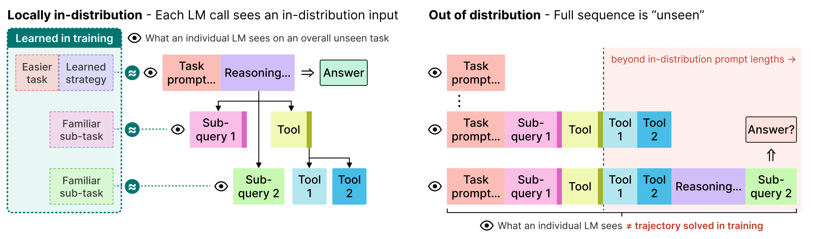

# Language Model Harnesses can be Compositional Generalizers — Experiments



This repository is the code for reproducing every experiment in the paper, and a starting point to fork for your own:
the harnesses ([RLM](https://arxiv.org/abs/2512.24601), [CodeAct](https://arxiv.org/abs/2402.01030) / LM + REPL,
[Pi](https://github.com/earendil-works/pi)) and the base Transformer + [YaRN](https://arxiv.org/abs/2309.00071), all
benchmark environments, and the configs and launchers behind each figure and table. The run logs and trajectories of
our experiments are released on Hugging Face (below).

| Directory | Contents |
|---|---|
| [`src/rlm_train/`](src/rlm_train/) | the harnesses as verifiers environments: RLM (one REPL subprocess per rollout), LM + REPL, Pi |
| [`environments/`](environments/) | benchmark packages: `real/`, `synthetic/` (§4.2), `singleturn/` (base Transformer + YaRN), `pi/`, `rl_staging/` ([catalogue](environments/README.md)) |
| [`training/`](training/) | trainer backends (`prime_rl/`, `tinker/`), SFT, and model serving ([details](training/README.md)) |
| [`experiments/`](experiments/) | one directory per paper section, each with its figure, configs, run scripts and README ([index](experiments/README.md)) |
| [`synth-datagen/`](synth-datagen/) | how the synthetic SFT traces were generated |

## Released artifacts

| | Artifact | Contents |
|---|---|---|
|  | [**harness_compgen_exp_logs**](https://huggingface.co/datasets/a1zhang/harness_compgen_exp_logs) | run logs and trajectories of all experiments |
|  | [**RLM-27B**](https://huggingface.co/a1zhang/RLM-27B) | Qwen3.8-27B after synthetic-environment SFT (§4.2) |
|  | [**RLM-27B-TailRecurse**](https://huggingface.co/a1zhang/RLM-27B-TailRecurse) | RLM-27B after tail-recursion SFT (§4.3) |
|  | [**Qwen3.8-27B-TailRecurse**](https://huggingface.co/a1zhang/Qwen3.8-27B-TailRecurse) | Qwen3.8-27B after tail-recursion SFT (§4.3) |
|  | [**synthetic-rlm-data-clean**](https://huggingface.co/datasets/a1zhang/synthetic-rlm-data-clean) | synthetic SFT traces (§4.2) |
|  | [**rlm-tail-recursion-sft-data**](https://huggingface.co/datasets/a1zhang/rlm-tail-recursion-sft-data) | tail-recursion SFT data (§4.3) |

## Setup

Linux, Python 3.12, [`uv`](https://docs.astral.sh/uv/). The largest runs use one node with 8 x 80 GB GPUs.

1. **Training backend.** We ran every experiment with [prime-rl](https://github.com/PrimeIntellect-ai/prime-rl). This
   clones it at the pinned commit, applies our patches, and installs this repo and all environment packages into it:
   ```bash
   PRIME_RL_DIR=~/prime-rl bash training/prime_rl/install.sh
   ```
   The LoRA experiments also run on [Tinker](https://tinker-docs.thinkingmachines.ai/) (`BACKEND=tinker`, no GPUs
   needed; see [training/tinker](training/tinker/README.md)).
2. **Pi** (only for Pi runs): `bash src/rlm_train/pi/install_node_pi.sh`.
3. **Credentials** in `$PRIME_RL_DIR/.env`: `WANDB_API_KEY`, `HF_TOKEN`, and `PRIME_API_KEY` for hosted models and
   LLM judges (plus `PRIME_API_TEAM` if your key bills to a team). Any OpenAI-compatible endpoint works instead
   (`OPENAI_BASE_URL` / `OPENAI_API_KEY`, or `RLM_JUDGE_BASE_URL` / `RLM_JUDGE_API_KEY` for judges).
4. **Data.** Benchmarks download from Hugging Face on first use. Two need a local copy: Ada-LEval
   (`ADALEVAL_DATA_DIR`, see `environments/real/ada_leval`) and OOLONG-Real (`OOLONG_REAL_DATA_DIR`, see
   `environments/synthetic/oolong_real`).

## Running an experiment

Each `experiments/<section>/README.md` lists the commands for its figure or table, e.g.:

```bash
cd experiments/sec3.1_length_generalization
bash run_train.sh rlm_orchestrator_prompt oolong                  # prime-rl on the current node
BACKEND=tinker bash run_train.sh rlm_orchestrator_prompt oolong   # Tinker
```

**SLURM.** Each experiment directory includes example batch scripts in `slurm/` (add your partition / account).

Runs are written to `$PRIME_RL_DIR/outputs/`.
