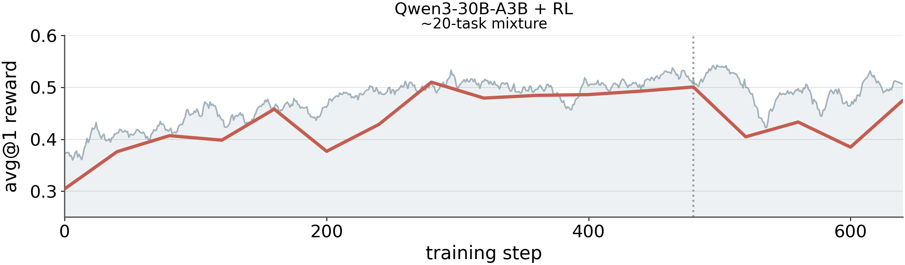

# Appendix A: broad task mixture (Fig. `broad-mixture-rl`, Tables `broad-mix`, `broad-ablation-*`)



RL of Qwen3-30B-A3B (LoRA) on 26 training streams, validated inline on 18 held-out streams
(`configs/train-mix-large.toml`; 4 trainer + 4 inference GPUs on one node).

```bash
bash run_train.sh [extra `rl` args]     # -> $PRIME_RL_DIR/outputs/train-mix-large
```

The paper evaluates the step-480 adapter on the held-out suite (`../../sec4.1_rl_on_short_tasks/eval/`); it is the
"+ RL (broad task suite)" row of Table `broad-ablation-results`. The streams use packages under `environments/real/`,
all installed by `training/prime_rl/install.sh`; the Ada-LEval streams need `ADALEVAL_DATA_DIR` (see
`environments/real/ada_leval`), the others download their data on first use.
