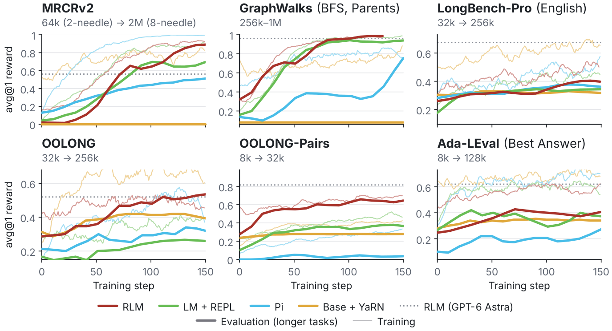
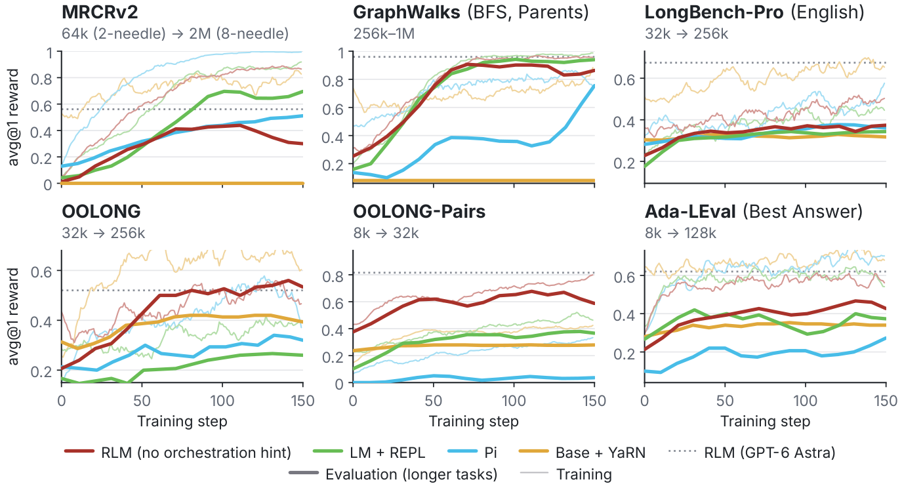

# §3.1 Length generalization (Fig. length-gen, Table `benchmarks`)





Train on the short split, evaluate on a split at least 4x longer. Model: Qwen3-30B-A3B-Instruct-2507, LoRA,
150 steps, eval every 10 steps (n = 50; LongBench-Pro 115, OOLONG-Pairs 20).

| Task | Train | Eval |
|---|---|---|
| `mrcr` | MRCRv2, 2 needles, 32k-64k | 8 needles, 2m-4m |
| `graphwalks` | <=128k | 256k-1M |
| `longbenchpro` | English, 32k | English, 256k |
| `oolong` | trec_coarse, 32k | trec_coarse, 256k |
| `oolong-pairs` | 8k | 32k |
| `adaleval` | BestAnswer 8k (798 ids) | BestAnswer 128k (50 disjoint ids) |

```bash
bash run_train.sh <rlm|rlm_orchestrator_prompt|lm_repl|pi|transformer> <task>   # configs/<method>/<task>.toml
bash eval_transformer.sh <task>          # Transformer long evals on saved adapters (YaRN where needed)
bash eval_lm_repl.sh oolong              # LM + REPL OOLONG long eval on saved adapters (262,144 window)
PRIME_API_KEY=... [PRIME_API_TEAM=...] bash frontier/run_astra.sh   # GPT-6 Astra RLM reference line -> frontier/results/gpt-6-astra
python frontier/collect_baseline.py      # -> frontier/baseline.json
```

`SEED=<n>` (default 42) seeds example order, vLLM and the LoRA init; a seed other than 42 writes to
`<output_dir>-seed<n>`.

Notes
- RLM, RLM + orchestrator prompt, LM + REPL (except OOLONG) and Pi on GraphWalks and OOLONG are evaluated inline by
  the trainer on the long split. LM + REPL on OOLONG trains at a 16,384-token window and is evaluated on its saved
  adapters (`eval_lm_repl.sh`).
- Every Pi run uses hard limits (`pi_runs/settings.py`: 30 root turns, 100 sub-agent calls, 10 turns per sub-agent,
  wall-clock caps). On MRCRv2, LongBench-Pro, OOLONG-Pairs and Ada-LEval it trains with seed 0 and its saved adapters
  are evaluated separately: `pi_runs/`.
- Ada-LEval needs `ADALEVAL_DATA_DIR` (see `environments/real/ada_leval`). Pi needs node + pi
  (`src/rlm_train/pi/install_node_pi.sh`).
- Per-method differences from the shared settings are in the configs: Pi samples at temperature 0.7 / top-p 0.8 /
  top-k 20; the Transformer's `seq_len` / window are sized to the short split; OOLONG-Pairs
  uses 30 turns and a 1,000 sub-call cap.
