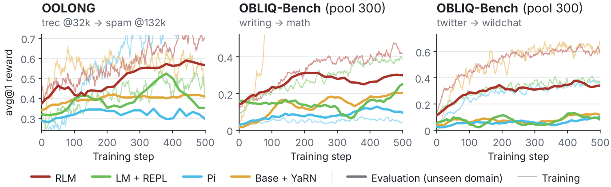

# §3.2 Strategy generalization (Fig. strategy-gen, Table `strategy-benchmarks`)



Train on one domain, evaluate inline on a disjoint domain with the same decomposition structure. Same setup as
§3.1, 500 steps.

| Task | Train | Eval |
|---|---|---|
| `oolong_trec_to_spam` | OOLONG trec_coarse, 32k | OOLONG spam, 132k (n = 50) |
| `obliq_writing_to_math` | OBLIQ writing, pool 300 | OBLIQ math, pool 300 (n = 50) |
| `obliq_twitter_to_wildchat` | OBLIQ twitter, pool 300 | OBLIQ wildchat, pool 300 (n = 35, all WildChat queries) |

```bash
bash run_train.sh <rlm|lm_repl|pi|transformer> <task>
```

Notes
- The RLM configs use the orchestrator prompt and a task hint (`user_prologue`); LM + REPL keeps the hint.
- OBLIQ trains on nDCG@50; the figure reports nDCG@10 (`obliq_ndcg10`, logged for eval rollouts by prime-rl patch 0002).
- Pi uses the same hard limits as the length-generalization Pi runs (`../sec3.1_length_generalization/pi_runs/settings.py`).
