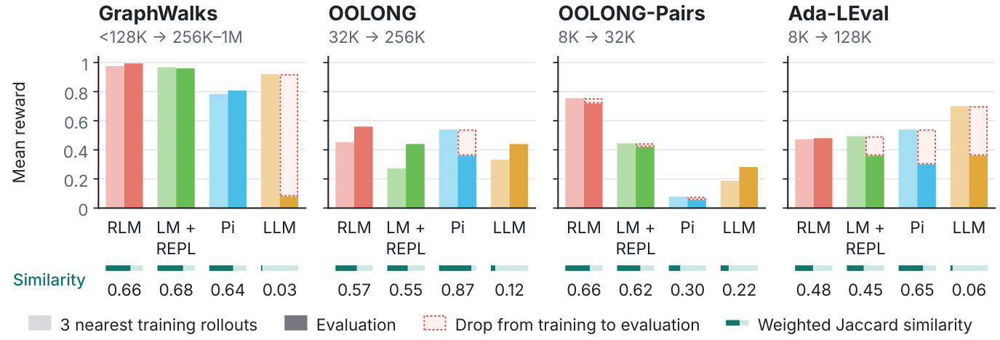
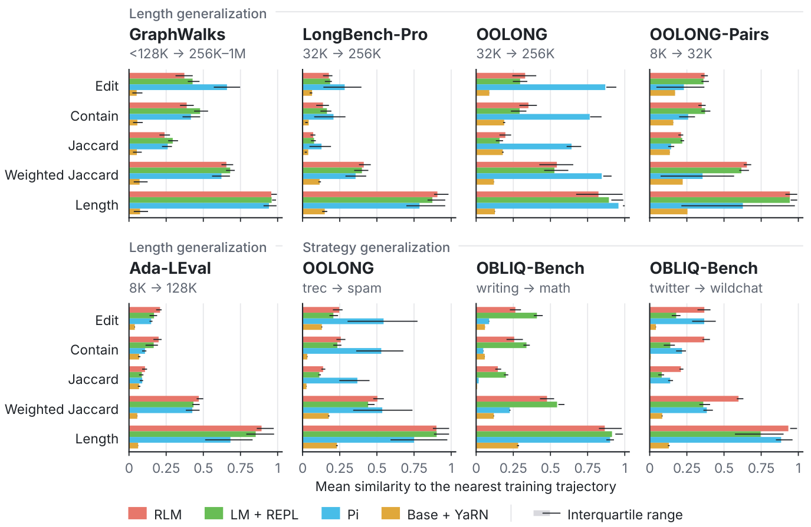

# §3.3 / App. D: trajectory similarity (Fig. jaccard, Fig. similarity, trajectory examples)





Reads the §3.1 / §3.2 runs under `$PRIME_RL_DIR/outputs/<length-gen|strategy-gen>/<method>/<task>` (no training).
Checkpoint per run: highest mean eval `reward` (OBLIQ: nDCG@50), earliest on ties; training pool: `train.step <= eval.step`.
Python deps: `requirements.txt`. Transformer long-split prompts (offline evals keep none) need the env packages:

```bash
for t in graphwalks longbenchpro oolong; do python regen_baseline_eval.py --task $t; done  # cache/regen_baseline_eval/
python run_distance.py --all                                   # results/distance/<panel>/<method>.json
python run_distance.py --panel oolong-pairs --harnesses pi --cand-k 32 --weighted-jaccard exact   # as published
python run_distance.py --panel obliq_twitter_to_wildchat --harnesses rlm --max-eval-step 150      # as published
python neighbor_rewards.py --workers 8   # 3 nearest training rollouts by Weighted Jaccard -> results/neighbor_rewards/
```

`trajectory_examples/` renders the appendix trajectory pairs. `simlib/runs.py` defines the panels, the run layout and the checkpoint rule.
