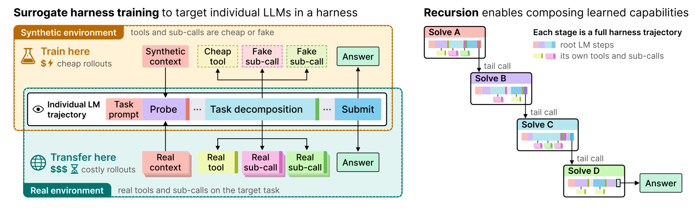

# §4.2 Synthetic environments (Table `main-composition`, "+ SFT" and "+ RL (synthetic tasks)" rows)



Two ways of using the eight synthetic environments (`environments/synthetic/`): SFT on traces generated in them
(`a1zhang/RLM-27B`), and RL directly on them. Both are evaluated on the held-out suite
(`../sec4.1_rl_on_short_tasks/eval/`).

## SFT (`sft/`)

Builds the training subset of `a1zhang/synthetic-rlm-data-clean` and trains Qwen3.8-27B on it; see
`sft/README.md`. How the traces themselves were generated: `synth-datagen/`.

## RL (`rl/`)

Equal-weight mixture of the eight environments, no hints; BrowseComp-Plus, CTC, ExpertLongBench and OBLIQ use
programmed sub-call responses.

```bash
bash rl/run_train.sh qwen3-30b-a3b                          # LoRA; the paper evaluates the step-207 adapter
bash rl/run_train.sh qwen38-27b                             # full fine-tuning, 150 steps
```

The 27B layout is 6 trainer + 2 inference GPUs on one 8 x 80 GB node.

