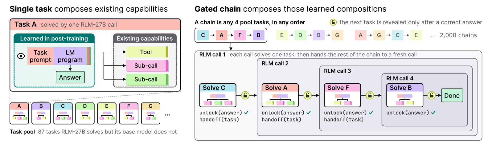

# §4.3 Composition over gated task chains (Table `recursion-composition`, App. B)



A chain is four tasks from a fixed pool of 87 (LongReason 29, LooGLE-v2 54, CorpusQA 4; `data/pool.json`). Only
the first task is visible; `unlock(answer)` reveals the next one when the answer passes that task's own scorer
(2 attempts per task); `handoff(pkg)` starts a fresh RLM call on the revealed task (tail recursion). Evaluation
uses the same 2,000 chains for every cell (`data/chains2000.json`: 500 chains drawn with seed 20261110, then 1,500
more that repeat none of them); `data/chains_dev20.json` is a quick check set.

| File | Purpose |
|---|---|
| `gated_chain.py`, `header.py` | the gate and the progress line |
| `run_gated.py`, `eval.sh` | evaluation; conditions `gflat` (RLM harness), `ghint` (+ hint), `gplain` (+ SFT) |
| `tasks.py`, `items_*.py` | pool tasks loaded from their benchmark envs, scored by their own scorers |
| `run_solo.py` | each pool task alone, 3 runs (the single-task scores quoted with the table) |
| `fake_world.py` | seven families of generated tasks and the scripted sub-call reader used for training data |
| `generate_teacher_levels.py`, `build_sft.py`, `to_parquet.py` | the gated SFT corpus |
| `sft/` | SFT configs and launcher for RLM-27B and Qwen3.8-27B (step-100 checkpoint is evaluated; released as `a1zhang/RLM-27B-TailRecurse` and `a1zhang/Qwen3.8-27B-TailRecurse`) |
| `stats.py` | both tables from run directories |

Requirements: `rlms==0.1.3`, the LongReason / LooGLE-v2 / CorpusQA env packages, their HF datasets.

```bash
# serve a model (TP 2, 262144 window) and the router
MODEL=a1zhang/RLM-27B SERVED=rlm-27b POOL=pool.json TOKENIZER=Qwen/Qwen3.8-27B bash training/serving/serve_vllm.sh &
LB_POOL=pool.json python training/serving/lb_proxy.py --listen 18431 &
# the three cells of one row
BASE_URL=http://127.0.0.1:18431/v1 MODEL=rlm-27b bash eval.sh harness
BASE_URL=http://127.0.0.1:18431/v1 MODEL=rlm-27b bash eval.sh hint
BASE_URL=http://127.0.0.1:18431/v1 MODEL=rlm-27b-gated-sft bash eval.sh sft     # after serving a1zhang/RLM-27B-TailRecurse
python stats.py runs/*
# single-task scores
python run_solo.py --base-url http://127.0.0.1:18431/v1 --model rlm-27b --reps 3 --temperature 0 --sub-thinking --out runs/solo/rlm-27b

# training data (teacher = RLM-27B, temperature 0.3) and SFT
python generate_teacher_levels.py --base-url ... --model rlm-27b --chains 950 --header post --teacher-hint-share 0.6 --out runs/teacher
python build_sft.py runs/teacher runs/sft_gated.jsonl && python to_parquet.py runs/sft_gated.jsonl runs/sft_gated
# or use the paper's SFT set (7,705 samples): https://huggingface.co/datasets/a1zhang/rlm-tail-recursion-sft-data
huggingface-cli download a1zhang/rlm-tail-recursion-sft-data --repo-type dataset --local-dir runs/sft_gated
SFT_DATA_DIR=runs/sft_gated INIT_WEIGHTS=<RLM-27B dir> PRIME_RL_SFT_GATED_DIR=... bash sft/run_sft.sh rlm-27b
SFT_DATA_DIR=runs/sft_gated PRIME_RL_SFT_GATED_DIR=... bash sft/run_sft.sh qwen38-27b
```

The pool was selected from the held-out suite results (tasks RLM-27B solves reliably and the base model does not;
App. B); `data/pool.json` is the frozen result.
